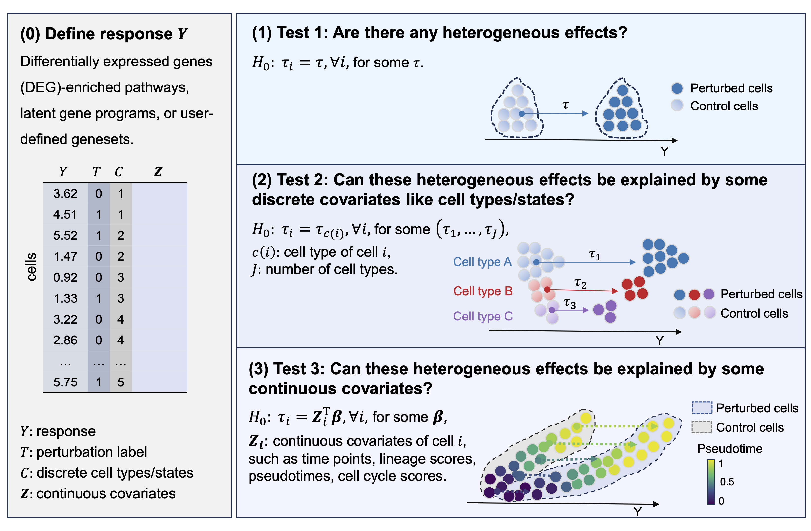

# scHPT
Tests for detecting and explaining heterogeneous effects in single-cell perturbation data

### Method Overview


scHPT consists of three hypothesis test.

* Test 1 evaluates whether perturbation effects are homogeneous across all cells. 

* Test 2 considers discrete covariates, such as cell types or cell lines, and tests whether variation across cell subgroups explains the full variation in perturbation effects. This allows identification of specific subpopulations exhibiting heterogeneous responses. 

* Test 3 extends this idea to continuous covariates, such as time or dosage, by testing whether perturbation effects can be captured by a covariate-dependent effect.

### Installation
scHPT is based on `python` version >=3.9, `numpy`, `pandas` and `scanpy`. Install directly from pip with:
```bash
pip install scHPT
```
### Basic Usage
```python
import scHPT
import numpy as np
import pandas as pd
import scanpy as sc
data_path = './data.h5ad' # data path
adata = sc.read_h5ad(data_path) # read data
```
**Test1**:
``` python
res=scHPT.permute_test(adata, Y_column, T_column,
                       pert_name, ctrl_name, n_perm=1000, verbose=True)
```
* Y_column: The column name of response (Y) in metadata 'adata.obs';
* T_column: The column name of perturbation (T) in metadata 'adata.obs';
* pert_name: The name of perturbed cells;
* ctrl_name: The name of control cells;
* n_perm: The number of permutations.
*'res' contains Test1 pvalue; pvalues, SKS, and corresponding taus in aggregation; estimation of tau and sd(tau).
**Test2**:
``` python
res_df=scHPT.permute_test_group(adata, Y_column, T_column, group_column,
                                pert_name, ctrl_name, n_cell_min=50, n_perm=1000)
```
* group_column: The column name of subgroup (e.g. cell lines) in metadata 'adata.obs';
* n_cell_min: The threshold of cell numbers in each subgroup.
*'res_df' contains Test2 pvalues;  estimations of tau and sd(tau) in each subgroup.
**Test3**:
``` python
res=scHPT.permute_test_cov(adata, Y_column, T_column, covs_columns=[''],
                           pert_name, ctrl_name, n_perm=1000)
```
* covs_columns: A list containing the column names of covariates in metadata 'adata.obs';
*'res' contains Test3 pvalue; pvalues, SKS, and betas in aggregation; estimation of beta and cov(beta).

